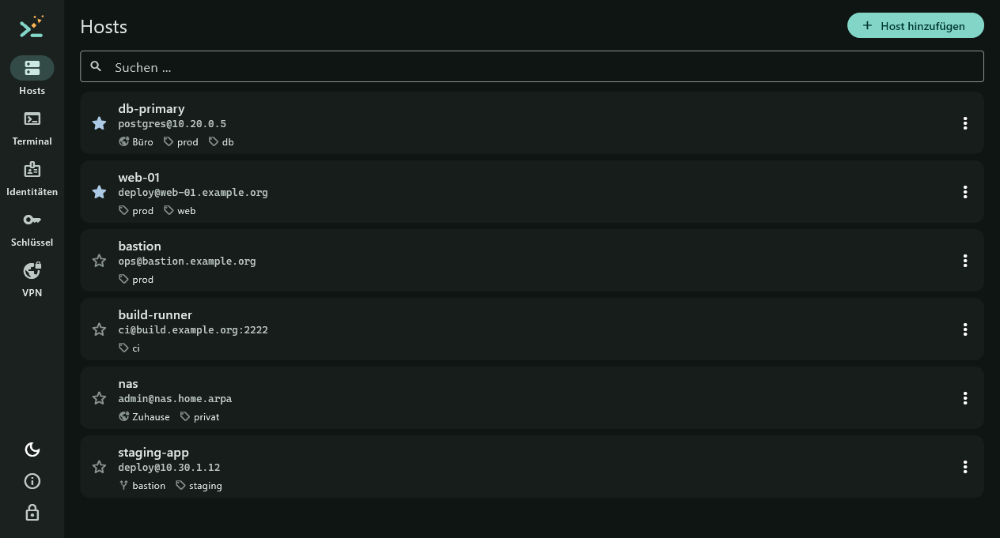

# Tephra

🇬🇧 [English](README.md) · 🇩🇪 Deutsch

> SSH-Client mit Zugangstresor, einem VPN-Tunnel pro Host, einem lokalen MCP-Server für Sprachmodelle und einem
> kleinen, selbst gehosteten Sync-Server, der nur Chiffrate zu sehen bekommt.

**Lizenz:** MIT · **Sprache:** Rust, Dart · **Läuft auf:** Windows, Linux, Android (nur die App) ·
**Stand:** Vorabversion, in Entwicklung



## Überblick

Tephra hält Hosts, Anmeldedaten, SSH-Schlüssel und VPN-Profile in einem verschlüsselten Tresor und
verbindet mit einem Befehl. Drei Dinge unterscheiden es von einem gewöhnlichen SSH-Client:

- **Ein VPN-Tunnel pro Host.** Einem Host lässt sich ein Profil für einen Tunnel über das WireGuard-Protokoll
  zuweisen. Der Tunnel läuft vollständig im Programm: kein Netzwerkadapter, keine Administratorrechte, kein
  System-VPN. Nur die Verbindungen von Tephra laufen hindurch, und mehrere Tunnel können gleichzeitig
  offen sein.
- **Ein MCP-Server auf dem eigenen Rechner.** Sprachmodelle können Befehle auf den Hosts ausführen, die du ihnen
  freigibst – und nur dort. Jeder Host hat eine Zugriffsstufe, jeder Aufruf wird protokolliert, und Zugangsdaten
  verlassen den Tresor nie.
- **Abgleich ohne Vertrauen in den Server.** Ein kleiner Server, den du selbst betreibst, hält deine Geräte auf
  demselben Stand. Verschlüsselt wird auf dem Gerät; der Server speichert Chiffrate und Revisionsnummern und kann
  nichts lesen.

## Status

Das Projekt wird aktiv entwickelt. **Was es heute gibt:**

- `tephra` – Tresor, Hosts, Identitäten, SSH-Schlüssel, VPN-Profile, Snippets, interaktive Sitzungen (`tephra ssh`),
  einzelne Befehle (`tephra exec`), Portweiterleitungen (`tephra forward`), Übernahme aus `~/.ssh/config`, Abgleich
  (`tephra sync …`), MCP-Zugriff (`tephra mcp …`) und der Hintergrunddienst (`tephra daemon`)
- `tephra-server` – der Sync-Server
- Die grafische App für Windows, Linux und Android in einer ersten Fassung (Ordner `app/`): Tresor anlegen und
  entsperren, Hosts, Identitäten, Schlüssel und WireGuard-Profile verwalten, Terminalsitzungen in Reitern – direkt, über
  Sprunghosts oder durch den Tunnel – und in jeder Sitzung ein Dateibrowser über SFTP. Unter Android mit einer Leiste
  von PC-Tasten (Esc, Tab, Strg, Alt, Pfeile, Funktionstasten, Einfügen) über der Tastatur; langes Antippen im
  Terminal wählt Text aus und kopiert ihn; offene Sitzungen bleiben verbunden,
  während die App im Hintergrund ist. Reißt eine Verbindung ab (Funkloch, Wechsel zwischen WLAN und Mobilnetz),
  verbindet die App von selbst neu; mit „Sitzung auf dem Host halten“ läuft die Sitzung auf dem Host in tmux, und
  die App hängt sich wieder an sie – Programme wie Claude Code laufen so weiter. Die App gleicht mit deinem Sync-Server ab, solange der Tresor offen ist – Telefon
  und Rechner teilen sich so einen Tresor –, und sie kann sich aus den Veröffentlichungen auf GitHub selbst
  aktualisieren.

**Noch nicht vorhanden:**

- In der App fehlen noch Snippets, Portweiterleitungen, das Übertragen ganzer Ordner, das Ändern des
  Master-Passworts, die Wiederherstellung mit dem Wiederherstellungsschlüssel, das automatische Sperren und unter
  Linux das Entsperren ohne Passwort; dafür gibt
  es die Kommandozeile, die unter Windows und Linux denselben Tresor verwendet. Unter Linux wird die App bisher nur
  vom automatischen App-Test geprüft; an einem echten Desktop hat noch niemand damit gearbeitet. Die Android-Fassung
  ist bisher nur im Emulator erprobt.
- Entfernte Portweiterleitungen, Anmeldung über einen SSH-Agenten und andere VPN-Protokolle als WireGuard.
- Proxys (SOCKS5, HTTP) und Host-Gruppen sind im Kern umgesetzt, haben aber noch keine Befehle.
- Signierte Windows-Programme. Windows warnt beim Start des Installers vor einem unbekannten Herausgeber.
- Die Kommandozeile spricht bisher nur Deutsch.
- Entwickelt wird unter Windows. Die Linux-Fassung wird bisher nur durch die automatischen Tests der CI geprüft.
- Der kryptografische Entwurf wurde noch von niemandem außerhalb des Projekts geprüft. Lies das
  [Bedrohungsmodell](docs/bedrohungsmodell.md), bevor du dich darauf verlässt.

## Funktionen

| Bereich | Was es kann |
|---|---|
| **Tresor** | Verschlüsselter lokaler Tresor in einer einzigen Datei; Master-Passwort und ein Wiederherstellungsschlüssel, der einmal angezeigt wird; verschlüsselte Sicherung mit `tephra export` |
| **Hosts & Anmeldung** | Hosts mit Tags; Identitäten mit gespeichertem Passwort, Passwortabfrage bei jeder Verbindung oder SSH-Schlüssel; Übernahme von Hosts, Benutzern, Schlüsseln und `ProxyJump` aus `~/.ssh/config` |
| **SSH-Schlüssel** | Ed25519-Schlüssel erzeugen, vorhandene einlesen (OpenSSH, PKCS#8, PEM, mit Passphrase); Schlüssel mit `--local-only` verlassen das Gerät nie |
| **SSH** | Interaktive Sitzungen und einzelne Befehle, Rückfragen des Servers wie Einmalcodes, Ketten von Jump-Hosts, Keepalive |
| **Portweiterleitung** | Lokale Weiterleitungen (`-L`) und ein SOCKS5-Proxy (`-D`) über einen Host, auch durch Tunnel und Jump-Hosts; lauscht ohne andere Angabe nur auf 127.0.0.1 |
| **Hostschlüssel** | Vertrauen beim ersten Verbinden, harter Stopp, wenn sich ein bekannter Schlüssel ändert, bekannte Schlüssel werden zwischen deinen Geräten abgeglichen |
| **VPN** | Tunnel über das WireGuard-Protokoll im Programm, pro Host; Import und Export im `wg-quick`-Format, Schlüsselerzeugung, Handshake-Test, Namensauflösung durch den Tunnel |
| **Snippets** | Gespeicherte Befehle mit `{{Platzhaltern}}`, für Sprachmodelle über MCP nutzbar |
| **MCP** | Befehle, interaktive Sitzungen und Dateizugriff für Sprachmodelle; je Client und je Host; drei Zugriffsstufen, Bestätigung im Terminal, die genau zeigt, was laufen wird, Protokoll, das vor jeder Ausführung geschrieben wird, Not-Aus, der auch laufende Sitzungen beendet |
| **Abgleich** | Ende-zu-Ende-verschlüsselt, funktioniert offline und holt später nach, führt gleichzeitige Änderungen feldweise zusammen, Geräteliste mit Entfernen |
| **Sync-Server** | Ein Programm mit einer SQLite-Datei; Registrierung offen, mit Einladungscode oder geschlossen; Obergrenzen je Konto; Fehlversuche bei der Anmeldung je Benutzername und Absender begrenzt |

## Schnellstart

### Herunterladen

Auf der [Releases-Seite](https://github.com/Poldion/Tephra/releases) liegen zu jeder Version:

- **Windows:** `Tephra-<Version>-windows-x64-setup.exe` installiert die App, die Kommandozeile `tephra.exe` und den
  Sync-Server `tephra-server.exe` für deinen Benutzer, ohne Administratorrechte. `Tephra-<Version>-windows-x64.zip`
  ist dasselbe als tragbarer Ordner: irgendwohin entpacken.
- **Linux, App:** `tephra_<Version>_amd64.deb` für Ubuntu (ab 22.04) und Debian (ab 12) –
  `sudo apt install ./tephra_<Version>_amd64.deb`; es bringt auch `tephra` und `tephra-server` mit. Oder
  `Tephra-<Version>-x86_64.AppImage` für andere Distributionen: ausführbar machen und starten.
- **Linux, nur Kommandozeile:** `Tephra-<Version>-linux-x64.tar.gz` – `tephra` und `tephra-server`, statisch gelinkt,
  dazu eine systemd-Unit für den Server.
- **Sync-Server mit Docker:** `docker pull ghcr.io/poldion/tephra-server` (amd64 und arm64); unter [deploy/](deploy/)
  liegt eine Compose-Datei mit TLS-Proxy.
- **Android:** `Tephra-<Version>.apk` (ab Android 7). Ihr Signaturzertifikat hat den SHA-256-Fingerabdruck
  `6A:50:B9:6C:4C:67:9B:D9:9A:C2:FE:7C:8A:DE:CF:F6:27:22:EF:EC:CB:D3:F5:75:70:54:8D:0F:4C:D3:6D:E9`.

Zu jeder Datei gibt es eine Prüfsumme (`.sha256`).

### Bauen

Voraussetzungen: Rust 1.90 oder neuer und ein C-Compiler (für das mitgelieferte SQLite).

```bash
cargo build --release      # baut target/release/tephra und target/release/tephra-server
```

Lege `tephra` (und auf dem Server `tephra-server`) in einen Ordner, der im `PATH` steht.

Die grafische App braucht zusätzlich das [Flutter-SDK](https://docs.flutter.dev/get-started/install) (3.50 oder neuer)
und unter Windows die „Desktopentwicklung mit C++“ von Visual Studio:

```bash
cd app
flutter build windows --release      # baut app/build/windows/x64/runner/Release/
flutter build apk --release          # baut app/build/app/outputs/flutter-apk/app-release.apk
```

Der Kern in Rust wird dabei mitgebaut. Für Android braucht es zusätzlich ein JDK 17, das Android-SDK mit NDK und die
Rust-Ziele für Android; Einzelheiten stehen in [app/README.md](app/README.md). Unter Windows verwenden App und
Kommandozeile dieselbe Tresordatei, unter Android liegt der Tresor im privaten Datenordner der App.

### Erste Verbindung

```bash
tephra init                                              # legt den Tresor an, zeigt einmal den Wiederherstellungsschlüssel
tephra key generate laptop                               # gibt den öffentlichen Schlüssel für authorized_keys aus
tephra identity add admin --user admin --key laptop
tephra host add web 192.0.2.10 --identity admin
tephra ssh web                                           # interaktive Sitzung
tephra exec web -- df -h                                 # einzelner Befehl
```

Jeder Befehl fragt nach dem Master-Passwort. Ein Host, der nur über ein VPN erreichbar ist:

```bash
tephra vpn import buero buero.conf                       # wg-quick-Format
tephra vpn test buero                                    # gelingt der Handshake?
tephra host add db 10.8.0.5 --identity admin --vpn buero
tephra forward db -L 5432:localhost:5432                 # lokaler Port 5432 → Datenbank auf diesem Host
```

Schon eine OpenSSH-Konfiguration vorhanden? `tephra import-ssh-config` übernimmt ihre Hosts.

### Sync-Server

Auf dem Server (oder mit Docker: das Image `ghcr.io/poldion/tephra-server` und die Compose-Datei unter
[deploy/](deploy/)):

```bash
tephra-server serve            # lauscht auf 127.0.0.1:8787, davor gehört ein Reverse-Proxy mit TLS
tephra-server invite           # gibt einen Einladungscode für ein neues Konto aus
```

Auf dem ersten Gerät, danach auf jedem weiteren:

```bash
tephra sync register https://sync.example.org alice --invite <code>
tephra sync join https://sync.example.org alice          # auf einem neuen Gerät: holt alles ab
```

`tephra sync now` gleicht einmal ab; `tephra daemon` gleicht im Hintergrund fortlaufend ab.

Die App kann dasselbe hinter ihrem Wolkensymbol: „Konto anlegen“ auf dem ersten Gerät, „Vorhandenen Tresor abholen“
beim ersten Start jedes weiteren. Sie gleicht ab, solange der Tresor offen ist.

### MCP

```bash
tephra mcp add-client desktop                            # zeigt das Token ein einziges Mal
tephra mcp grant desktop web --level read-only
tephra daemon                                            # entsperrt den Tresor und wartet auf MCP-Clients
                                                         # (oder in der App im Bereich „MCP“ den Dienst einschalten)
```

In der MCP-Konfiguration deines Clients:

```json
{
  "mcpServers": {
    "tephra": {
      "command": "tephra",
      "args": ["mcp", "serve"],
      "env": { "TEPHRA_MCP_TOKEN": "tephramcp_…" }
    }
  }
}
```

Alle Befehle mit Beispielen: [Handbuch](docs/handbuch.md).

## Konfiguration

`tephra`:

| Variable | Standard | Bedeutung |
|---|---|---|
| `TEPHRA_VAULT` | `vault.tephra` im Datenordner des Benutzers | Pfad der Tresordatei (wie `--vault`) |
| `TEPHRA_PASSWORD` | – | Master-Passwort statt Eingabe (für Skripte) |
| `TEPHRA_PASSWORD_FILE` | – | Datei mit dem Master-Passwort, etwa für `tephra daemon` unter systemd |
| `TEPHRA_NEW_PASSWORD` | – | Neues Master-Passwort für `tephra init`, `tephra passwd` und `tephra recover` |
| `TEPHRA_IDENTITY_PASSWORD` | – | Passwort, das `tephra identity add` speichert |
| `TEPHRA_KEY_PASSPHRASE` | – | Passphrase des Schlüssels für `tephra key import` |
| `TEPHRA_MCP_TOKEN` | – | Token des MCP-Clients für `tephra mcp serve` |

Der Datenordner ist unter Windows `%APPDATA%\Tephra\data`, unter Linux `~/.local/share/tephra`.

`tephra-server`:

| Variable | Standard | Bedeutung |
|---|---|---|
| `TEPHRA_SERVER_DB` | `tephra-server.sqlite` | Pfad der Datenbankdatei (wie `--db`) |
| `TEPHRA_SERVER_BIND` | `127.0.0.1:8787` | Adresse, auf der der Server lauscht |
| `TEPHRA_SERVER_REGISTRATION` | `invite` | Wer Konten anlegen darf: `open`, `invite` oder `closed` |
| `TEPHRA_SERVER_MAX_ITEMS` | `50000` | Höchstzahl an Datensätzen je Konto |
| `TEPHRA_SERVER_MAX_MIB` | `256` | Höchste Datenmenge je Konto in MiB |
| `TEPHRA_SERVER_BEHIND_PROXY` | aus | Auf `true` setzen hinter einem Reverse-Proxy, der `X-Forwarded-For` setzt: Fehlversuche bei der Anmeldung werden dann nach der Adresse aus diesem Kopf begrenzt |

Zu jeder Variable gibt es eine gleichnamige Option (`--bind`, `--behind-proxy` …). Der Server spricht einfaches HTTP
und gehört hinter einen Reverse-Proxy mit TLS. Clients lehnen `http://`-Adressen ab, außer für `localhost` – es sei
denn, du erlaubst sie für einen Server im eigenen Netz ausdrücklich (`--allow-http`, in der App „Unverschlüsselt
verbinden“); was du damit aufgibst, steht im Handbuch.

## MCP

Der Tresor ist in genau einem Prozess entsperrt, in `tephra daemon`. Ein Sprachmodell startet `tephra mcp serve`, eine
dünne Brücke, die sich über einen lokalen Kanal (Named Pipe unter Windows, Unix-Socket in einem eigenen Verzeichnis
unter Linux) mit dem Dienst verbindet. Brücke und Dienst weisen einander nach, dass sie das Token des Clients kennen,
ohne es zu übertragen. Ohne Freigabe ist nichts erlaubt; Hosts, die einem Client nicht freigegeben sind, existieren für
ihn nicht.

| Stufe | Was das Modell darf |
|---|---|
| `read-only` | Nur eine feste Auswahl anzeigender Programme (`ls`, `cat`, `df`, `journalctl`, `systemctl status` …), jeweils mit festgelegten Optionen; keine Verkettungen, Umleitungen, Anführungszeichen oder Platzhalter, keine Eingabedaten, keine interaktiven Sitzungen. Pfade, die nach Zugangsdaten aussehen, werden abgelehnt |
| `confirm` (Standard) | Jeder Befehl erscheint im Terminal von `tephra daemon` – samt Eingabedaten, bei Dateien mit Größe, Prüfsumme und Anfang des Inhalts – und läuft erst nach deiner Zustimmung. Muster aus `--allow` laufen ohne Rückfrage |
| `auto` | Befehle laufen ohne Rückfrage, sofern sie nicht auf der Sperrliste stehen (`rm -rf /`, `mkfs`, `shutdown` … und zusätzlich eigene Muster mit `--deny`) |

- Dateizugriff über SFTP ist ein eigenes Recht: `--files-read`, `--files-write`.
- **Not-Aus:** `tephra mcp disable` stoppt binnen Sekunden alles, auch Sitzungen und Befehle, die schon laufen. Der
  Entzug eines einzelnen Hosts oder Clients wirkt genauso.
- **Protokoll:** Jede Aktion wird protokolliert, bevor sie läuft – lässt sie sich nicht protokollieren, läuft sie
  nicht – und noch einmal, wenn sie beendet ist. Abgelehnte Aufrufe und Versuche auf nicht freigegebene Hosts stehen
  ebenfalls darin. `tephra mcp audit` zeigt das Protokoll; es liegt verschlüsselt auf diesem Gerät und wird nie
  abgeglichen.
- Zugangsdaten werden nie zurückgegeben. Die Passwörter und Schlüssel, mit denen ein Host erreicht wird, werden
  geschwärzt, wenn sie in seiner Ausgabe auftauchen.
- Grenzen: 120 Aufrufe pro Minute und Client, 4 interaktive Sitzungen, 60 Sekunden je Befehl, wenn nichts anderes
  angegeben ist.

Mach dir nichts vor, wovor das schützt. Die Sperrliste von `auto` verhindert Versehen, keinen Missbrauch – eine
Sperrliste lässt sich immer umgehen. `read-only` verändert auf dem Host nichts, umfasst aber alles, was der
SSH-Benutzer lesen darf; dass Pfade abgelehnt werden, die nach Zugangsdaten aussehen, ist eine Hürde gegen Versehen,
keine Schranke. Eigene Muster mit `--allow` ersetzen die eingebaute Prüfung vollständig. Eine interaktive Sitzung wird
einmal beim Öffnen bestätigt, nicht je Eingabe. Und was ein Modell liest, geht an den, der das Modell betreibt.

## Sicherheit

- **Master-Passwort.** Daraus wird mit Argon2id (64 MiB, 3 Durchläufe) ein Schlüssel abgeleitet. Es verlässt das
  Gerät nie.
- **Vault Key.** Ein zufälliger 256-Bit-Schlüssel verschlüsselt jeden Datensatz mit XChaCha20-Poly1305. Er liegt
  zweifach verpackt vor: mit dem Schlüssel aus dem Master-Passwort und mit dem Wiederherstellungsschlüssel.
- **Wiederherstellungsschlüssel.** Wird von `tephra init` einmal angezeigt und nirgends gespeichert. `tephra recover`
  setzt damit ein neues Master-Passwort. Ohne Master-Passwort und Wiederherstellungsschlüssel sind die Daten verloren –
  eine Hintertür gibt es nicht.
- **Auf der Festplatte.** Die Tresordatei enthält nur Chiffrate. Entsperren entschlüsselt in den Arbeitsspeicher,
  Sperren verwirft ihn.
- **Was der Sync-Server sieht:** den Benutzernamen, Gerätenamen und wann sie zuletzt gesehen wurden, den verpackten
  Vault Key und je Datensatz eine Kennung, eine Revisionsnummer, einen Löschmarker und eine auf feste Stufen
  aufgerundete Größe.
- **Was er nicht sieht:** Inhalte, Arten der Datensätze, Hostnamen, Benutzernamen auf Hosts, Schlüssel.
- **Was er trotzdem kann:** Änderungen oder Löschungen zurückhalten, einem neuen Gerät einen älteren Stand liefern,
  Daten löschen und ein schwaches Master-Passwort offline zu erraten versuchen. Zurückgehaltenes bemerken die Geräte
  nicht; gefälschte oder veränderte Daten und ein gefälschter oder veralteter Tresorkopf werden erkannt.
- **Ein entferntes Gerät** gleicht nicht mehr ab. Was es bereits abgeholt hat, bleibt dort lesbar, und der Vault Key
  wird nicht ersetzt – geht ein Gerät verloren, erneuere die Zugangsdaten deiner Hosts.

Einzelheiten, auch dazu, was bewusst außerhalb des Schutzumfangs liegt:
[docs/bedrohungsmodell.md](docs/bedrohungsmodell.md). Sicherheitslücken melden: [SECURITY.md](SECURITY.md).

## Dokumentation

- [docs/handbuch.md](docs/handbuch.md) – alle Befehle mit Beispielen, MCP einrichten, Sync-Server betreiben
  (Englisch: [manual.md](docs/manual.md))
- [docs/bedrohungsmodell.md](docs/bedrohungsmodell.md) – was wovor geschützt ist und was nicht
  (Englisch: [threat-model.md](docs/threat-model.md))
- [docs/lizenzen.md](docs/lizenzen.md) – Lizenzen aller Abhängigkeiten und die Pflichten daraus
- [deploy/](deploy/) – Dockerfile, Compose-Datei mit Caddy, systemd-Unit für den Sync-Server
- [CHANGELOG.md](CHANGELOG.md) – Versionsgeschichte (Englisch)
- [CONTRIBUTING.md](CONTRIBUTING.md) – Entwicklungsumgebung, Tests, Richtlinien (Englisch)
- [SECURITY.md](SECURITY.md) – Sicherheitslücken melden (Englisch)

## Entwicklung

```bash
cargo test --workspace
cargo clippy --workspace --all-targets -- -D warnings
cargo fmt --all --check
cargo deny --locked check      # Lizenzen und Sicherheitsmeldungen, braucht cargo-deny
```

Aufbau: `crates/tephra-model` (Datenmodell, zusammenführbare Datensätze), `tephra-crypto` (Schlüsselhierarchie,
Verschlüsselung der Datensätze), `tephra-vault` (verschlüsselter Tresor auf SQLite), `tephra-transport` (direkt, Proxy,
Tunnel im Prozess), `tephra-ssh` (SSH-Client, Jump-Hosts, SFTP), `tephra-core` (Fassade), `tephra-mcp` (MCP-Server,
Freigaben, Protokoll), `tephra-sync-proto` und `tephra-sync` (Abgleich: Protokoll und Client), `tephra-server`
(Sync-Server), `tephra-cli` (das Programm `tephra`). `unsafe`-Code ist in allen diesen Crates verboten. Die App liegt in
`app/` (Flutter, Dart) und spricht über `app/rust` (erzeugte Brücke) mit `tephra-core`. Ihr Test fährt die echte App
gegen den SSH-Testserver aus `tephra-ssh`; die Schritte stehen am Anfang von `app/integration_test/app_test.dart`.

## Lizenz & Drittanbieter

Der Code steht unter der [MIT-Lizenz](LICENSE). Verwendete Software und ihre Lizenzen:
[THIRD_PARTY_NOTICES.md](THIRD_PARTY_NOTICES.md).

„WireGuard“ ist eine eingetragene Marke von Jason A. Donenfeld. Tephra ist ein unabhängiges Projekt; es
steht in keiner Verbindung zum WireGuard-Projekt und wird von ihm weder unterstützt noch empfohlen.
