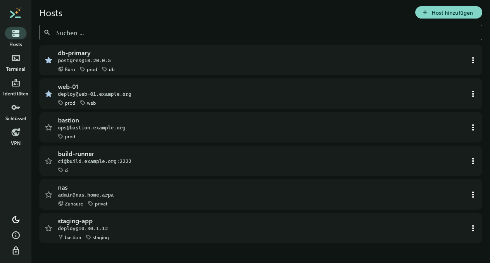

# Tephra

🇬🇧 English · 🇩🇪 [Deutsch](README.de.md)

> An SSH client with a credential vault, a VPN tunnel per host, a local MCP server for language models and a small
> self-hosted sync server that only ever sees ciphertext.

**License:** MIT · **Language:** Rust, Dart · **Runs on:** Windows, Linux, Android (app only) ·
**Status:** preview, in development



## Overview

Tephra keeps hosts, logins, SSH keys and VPN profiles in an encrypted vault and connects with one command.
Three things set it apart from a plain SSH client:

- **A VPN tunnel per host.** A host can be assigned a profile for a tunnel using the WireGuard protocol. The tunnel
  runs entirely inside the program: no network adapter, no administrator rights, no system VPN. Only the connections
  of Tephra go through it, and several tunnels can be open at the same time.
- **An MCP server on your own machine.** Language models can run commands on the hosts you share with them – and only
  on those. Every host has an access level, every call is logged, and credentials never leave the vault.
- **Sync without trust in the server.** A small server you host yourself keeps your devices in step. Everything is
  encrypted on the device; the server stores ciphertext and revision numbers and cannot read anything.

## Status

The project is under active development. **What exists today:**

- `tephra` – vault, hosts, identities, SSH keys, VPN profiles, snippets, interactive sessions (`tephra ssh`), single
  commands (`tephra exec`), port forwarding (`tephra forward`), import from `~/.ssh/config`, sync (`tephra sync …`), MCP
  access (`tephra mcp …`) and the background service (`tephra daemon`)
- `tephra-server` – the sync server
- A first version of the graphical app for Windows, Linux and Android (folder `app/`): create and unlock the vault,
  manage hosts, identities, keys and WireGuard profiles, terminal sessions in tabs – direct, through jump hosts or
  through the tunnel – and a file browser over SFTP in every session. On Android with a bar of PC keys (Esc, Tab,
  Ctrl, Alt, arrows, function keys) above the keyboard; open sessions stay connected while the app is in the
  background. The app syncs with your sync server while the vault is open, so the phone and the desktop share one
  vault, and it can update itself from the releases on GitHub.

**Not there yet:**

- The app still lacks snippets, port forwarding, transferring whole folders, changing the master
  password, recovery with the recovery key and automatic locking; the command line covers these and, on Windows and
  Linux, uses the same vault. On Linux the app is exercised by the automated app test only; nobody has worked with it
  on a real desktop yet. The Android version has only been tried in the emulator so far.
- Remote port forwarding, login through an SSH agent and VPN protocols other than WireGuard.
- Proxies (SOCKS5, HTTP) and host groups are implemented in the core but have no commands yet.
- Signed Windows programs. Windows will warn about an unknown publisher when the installer starts.
- The command line speaks German only.
- Development happens on Windows. The Linux build is so far exercised by the automated tests in CI only.
- The cryptographic design has not been reviewed by a third party. Read the [threat model](docs/threat-model.md)
  before you rely on it.

## Features

| Area | What it does |
|---|---|
| **Vault** | Encrypted local vault in a single file; master password plus a recovery key that is shown once; encrypted backup with `tephra export` |
| **Hosts & logins** | Hosts with tags; identities with a stored password, a password asked on every connection or an SSH key; import of hosts, users, keys and `ProxyJump` from `~/.ssh/config` |
| **SSH keys** | Generate Ed25519 keys, import existing ones (OpenSSH, PKCS#8, PEM, with passphrase); keys marked `--local-only` never leave the device |
| **SSH** | Interactive sessions and single commands, server prompts such as one-time codes, chains of jump hosts, keepalive |
| **Port forwarding** | Local forwards (`-L`) and a SOCKS5 proxy (`-D`) through a host, also through tunnel and jump hosts; listens on 127.0.0.1 unless told otherwise |
| **Host keys** | Trust on first use, a hard stop when a known key changes, known keys are synced between your devices |
| **VPN** | In-process tunnel using the WireGuard protocol, per host; import and export in `wg-quick` format, key generation, handshake test, names resolved through the tunnel |
| **Snippets** | Stored commands with `{{placeholders}}`, available to language models through MCP |
| **MCP** | Commands, interactive sessions and file access for language models; per client and per host; three access levels, confirmation in the terminal that shows exactly what will run, audit log written before anything runs, kill switch that also ends running sessions |
| **Sync** | End-to-end encrypted, works offline and catches up later, merges concurrent changes field by field, device list with removal |
| **Sync server** | One binary with an SQLite file; registration open, by invite code or closed; quota per account; failed logins limited per user name and sender |

## Quick start

### Download

The [releases page](https://github.com/Poldion/Tephra/releases) has, for each version:

- **Windows:** `Tephra-<version>-windows-x64-setup.exe` installs the app, the command line `tephra.exe` and the sync
  server `tephra-server.exe` for your user, without administrator rights. `Tephra-<version>-windows-x64.zip` is the
  same as a portable folder: unpack it anywhere.
- **Linux, app:** `tephra_<version>_amd64.deb` for Ubuntu (22.04 or newer) and Debian (12 or newer) –
  `sudo apt install ./tephra_<version>_amd64.deb`; it also brings `tephra` and `tephra-server`. Or
  `Tephra-<version>-x86_64.AppImage` for other distributions: make it executable and start it.
- **Linux, command line only:** `Tephra-<version>-linux-x64.tar.gz` – `tephra` and `tephra-server`, statically
  linked, plus a systemd unit for the server.
- **Sync server with Docker:** `docker pull ghcr.io/poldion/tephra-server` (amd64 and arm64); see [deploy/](deploy/) for
  a Compose file with a TLS proxy.
- **Android:** `Tephra-<version>.apk` (Android 7 or newer). Its signing certificate has the SHA-256 fingerprint
  `6A:50:B9:6C:4C:67:9B:D9:9A:C2:FE:7C:8A:DE:CF:F6:27:22:EF:EC:CB:D3:F5:75:70:54:8D:0F:4C:D3:6D:E9`.

Each file comes with a `.sha256` checksum.

### Build

Requirements: Rust 1.90 or newer and a C compiler (for the bundled SQLite).

```bash
cargo build --release      # builds target/release/tephra and target/release/tephra-server
```

Put `tephra` (and on the server `tephra-server`) somewhere on your `PATH`.

The graphical app additionally needs the [Flutter SDK](https://docs.flutter.dev/get-started/install) (3.50 or newer)
and, on Windows, the "Desktop development with C++" workload of Visual Studio:

```bash
cd app
flutter build windows --release      # builds app/build/windows/x64/runner/Release/
flutter build apk --release          # builds app/build/app/outputs/flutter-apk/app-release.apk
```

The Rust core is built along with it. Android additionally needs a JDK 17, the Android SDK with the NDK and the Rust
targets for Android; see [app/README.md](app/README.md) for details. On Windows, app and command line use the same
vault file; on Android the vault lives in the private data folder of the app.

### First connection

```bash
tephra init                                              # creates the vault, shows the recovery key once
tephra key generate laptop                               # prints the public key for authorized_keys
tephra identity add admin --user admin --key laptop
tephra host add web 192.0.2.10 --identity admin
tephra ssh web                                           # interactive session
tephra exec web -- df -h                                 # single command
```

Every command asks for the master password. A host that is only reachable through a VPN:

```bash
tephra vpn import office office.conf                     # wg-quick format
tephra vpn test office                                   # does the handshake work?
tephra host add db 10.8.0.5 --identity admin --vpn office
tephra forward db -L 5432:localhost:5432                 # local port 5432 → database on that host
```

Already have an OpenSSH configuration? `tephra import-ssh-config` takes over its hosts.

### Sync server

On the server (or with Docker: the image `ghcr.io/poldion/tephra-server` and the Compose file in [deploy/](deploy/)):

```bash
tephra-server serve            # listens on 127.0.0.1:8787, put a TLS reverse proxy in front
tephra-server invite           # prints an invite code for a new account
```

On the first device, then on every further one:

```bash
tephra sync register https://sync.example.org alice --invite <code>
tephra sync join https://sync.example.org alice          # on a new device: fetches everything
```

`tephra sync now` syncs once; `tephra daemon` keeps syncing in the background.

The app does the same behind its cloud symbol: "Create account" on the first device, "Fetch an existing vault" on the
first start of every further one. It keeps syncing for as long as the vault is open.

### MCP

```bash
tephra mcp add-client desktop                            # shows the token once
tephra mcp grant desktop web --level read-only
tephra daemon                                            # unlocks the vault and waits for MCP clients
                                                         # (or switch on the service in the app's section "MCP")
```

In the MCP configuration of your client:

```json
{
  "mcpServers": {
    "tephra": {
      "command": "tephra",
      "args": ["mcp", "serve"],
      "env": { "TEPHRA_MCP_TOKEN": "tephramcp_…" }
    }
  }
}
```

All commands with examples: [manual](docs/manual.md).

## Configuration

`tephra`:

| Variable | Default | Meaning |
|---|---|---|
| `TEPHRA_VAULT` | `vault.tephra` in the user's data folder | Path of the vault file (same as `--vault`) |
| `TEPHRA_PASSWORD` | – | Master password, instead of typing it (for scripts) |
| `TEPHRA_PASSWORD_FILE` | – | File with the master password, for example for `tephra daemon` under systemd |
| `TEPHRA_NEW_PASSWORD` | – | New master password for `tephra init`, `tephra passwd` and `tephra recover` |
| `TEPHRA_IDENTITY_PASSWORD` | – | Password to store with `tephra identity add` |
| `TEPHRA_KEY_PASSPHRASE` | – | Passphrase of the key for `tephra key import` |
| `TEPHRA_MCP_TOKEN` | – | Token of the MCP client for `tephra mcp serve` |

The data folder is `%APPDATA%\Tephra\data` on Windows and `~/.local/share/tephra` on Linux.

`tephra-server`:

| Variable | Default | Meaning |
|---|---|---|
| `TEPHRA_SERVER_DB` | `tephra-server.sqlite` | Path of the database file (same as `--db`) |
| `TEPHRA_SERVER_BIND` | `127.0.0.1:8787` | Address the server listens on |
| `TEPHRA_SERVER_REGISTRATION` | `invite` | Who may create accounts: `open`, `invite` or `closed` |
| `TEPHRA_SERVER_MAX_ITEMS` | `50000` | Largest number of records per account |
| `TEPHRA_SERVER_MAX_MIB` | `256` | Largest amount of data per account in MiB |
| `TEPHRA_SERVER_BEHIND_PROXY` | off | Set to `true` behind a reverse proxy that sets `X-Forwarded-For`: failed logins are then limited per address from that header |

Every variable has an option of the same name (`--bind`, `--behind-proxy` …). The server speaks plain HTTP and belongs
behind a reverse proxy with TLS. Clients refuse `http://` addresses other than `localhost` unless you allow them
explicitly for a server in your own network (`--allow-http`, in the app "Connect without encryption"); see the manual
for what that gives up.

## MCP

The vault is unlocked in exactly one process, `tephra daemon`. A language model starts `tephra mcp serve`, a thin bridge
that connects to the daemon over a local channel (named pipe on Windows, Unix socket in a directory of your own on
Linux). Bridge and daemon prove to each other that they know the client's token without sending it. Nothing is shared by
default; hosts that are not shared with a client do not exist for it.

| Level | What the model may do |
|---|---|
| `read-only` | Only a fixed set of inspecting programs (`ls`, `cat`, `df`, `journalctl`, `systemctl status` …), each with a fixed set of options; no pipes, redirects, quotes or wildcards, no input data, no interactive sessions. Paths that look like credentials are refused |
| `confirm` (default) | Every command is shown in the terminal of `tephra daemon` – with its input data, for files with size, checksum and the beginning of the content – and runs only after you agree. Patterns given with `--allow` run without asking |
| `auto` | Commands run without asking unless they match the deny list (`rm -rf /`, `mkfs`, `shutdown` … plus your own `--deny` patterns) |

- File access over SFTP is a separate permission: `--files-read`, `--files-write`.
- **Kill switch:** `tephra mcp disable` stops everything within seconds, including sessions and commands that are
  already running. Revoking a single host or client works the same way.
- **Audit log:** every action is written to the log before it runs – if it cannot be logged, it does not run – and
  again when it has finished. Refused calls and attempts on hosts that are not shared are logged too. `tephra mcp audit`
  shows the log; it is stored encrypted on this device and never synced.
- Credentials are never returned. The passwords and keys used to reach a host are blacked out if they appear in its
  output.
- Limits: 120 calls per minute and client, 4 interactive sessions, 60 seconds per command unless stated otherwise.

Be honest with yourself about what this protects against. The deny list of `auto` prevents accidents, not misuse – a
block list can always be worked around. `read-only` changes nothing on the host but covers everything the SSH user is
allowed to read; refusing paths that look like credentials is a hurdle against accidents, not a barrier. Your own
`--allow` patterns replace the built-in check completely. An interactive session is confirmed once when it is opened,
not per input. And whatever a model reads is sent to whoever runs the model.

## Security

- **Master password.** A key is derived from it with Argon2id (64 MiB, 3 passes). It never leaves the device.
- **Vault key.** A random 256-bit key encrypts every record with XChaCha20-Poly1305. It is stored wrapped twice: with
  the key from the master password and with the recovery key.
- **Recovery key.** Shown once by `tephra init` and stored nowhere. `tephra recover` sets a new master password with it.
  Without master password and recovery key the data is lost – there is no back door.
- **On disk.** The vault file contains ciphertext only. Unlocking decrypts into memory, locking discards it.
- **What the sync server sees:** the user name, device names and when they were last seen, the wrapped vault key, and
  per record an ID, a revision number, a deletion marker and a size rounded up to fixed steps.
- **What it does not see:** contents, record types, host names, user names on hosts, keys.
- **What it can still do:** withhold changes or deletions, hand a new device an older state, delete data, and try to
  guess a weak master password offline. Devices do not notice withheld data; forged or altered data and a forged or
  outdated vault header are detected.
- **Removing a device** ends its sync. Data it has already fetched stays readable there, and the vault key is not
  replaced – if a device is lost, renew the credentials of your hosts.

Details, including what is deliberately out of scope: [docs/threat-model.md](docs/threat-model.md). Reporting security
issues: [SECURITY.md](SECURITY.md).

## Documentation

- [docs/manual.md](docs/manual.md) – all commands with examples, setting up MCP, running the sync server
  (German: [handbuch.md](docs/handbuch.md))
- [docs/threat-model.md](docs/threat-model.md) – what is protected against whom, and what is not
  (German: [bedrohungsmodell.md](docs/bedrohungsmodell.md))
- [docs/lizenzen.md](docs/lizenzen.md) – licenses of all dependencies and the resulting obligations (German)
- [deploy/](deploy/) – Dockerfile, Compose file with Caddy, systemd unit for the sync server
- [CHANGELOG.md](CHANGELOG.md) – version history
- [CONTRIBUTING.md](CONTRIBUTING.md) – development setup, tests, guidelines
- [SECURITY.md](SECURITY.md) – reporting security issues

## Development

```bash
cargo test --workspace
cargo clippy --workspace --all-targets -- -D warnings
cargo fmt --all --check
cargo deny --locked check      # licenses and advisories, needs cargo-deny
```

Layout: `crates/tephra-model` (data model, mergeable records), `tephra-crypto` (key hierarchy, record encryption),
`tephra-vault` (encrypted vault on SQLite), `tephra-transport` (direct, proxy, in-process tunnel), `tephra-ssh` (SSH
client, jump hosts, SFTP), `tephra-core` (facade), `tephra-mcp` (MCP server, access rules, audit log),
`tephra-sync-proto` and `tephra-sync` (sync protocol and client), `tephra-server` (sync server), `tephra-cli` (the
`tephra` program). `unsafe` code is forbidden in the whole workspace.

## License & third parties

The code is licensed under the [MIT license](LICENSE). Software used and its licenses:
[THIRD_PARTY_NOTICES.md](THIRD_PARTY_NOTICES.md).

“WireGuard” is a registered trademark of Jason A. Donenfeld. Tephra is an independent project; it is not
affiliated with the WireGuard project and is neither supported nor endorsed by it.
